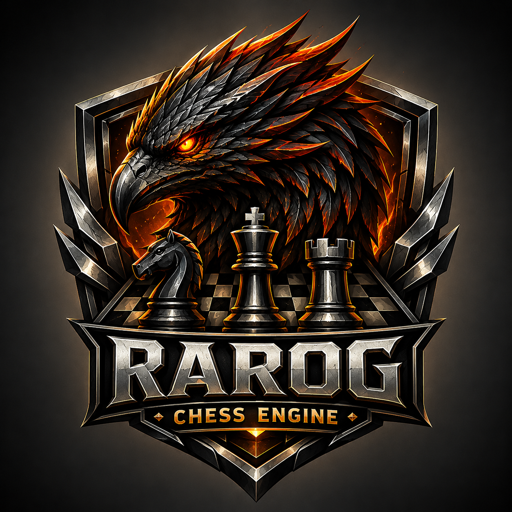

# Rarog

<p align="center">
  
</p>

Rarog is a strong UCI chess engine written in Rust. It is meant to be used from
a chess GUI or an engine-testing tool.

---

## Highlights

- **Strong modern search** — principal variation search with aspiration
  windows, null-move pruning, ProbCut, singular extensions, late move
  reductions, history and correction tables, and a quiescence search.
- **Multi-threaded** — parallel search that scales across cores, enabled with
  the standard `Threads` option; `MultiPV` for analysis.
- **Tuned evaluation** — a tapered evaluation fitted to millions of positions,
  covering king safety, mobility, threats, pawn structure and passed pawns,
  material imbalance and endgame knowledge.
- **Syzygy tablebases** — optional endgame tablebase probing, both in-search and
  at the root.
- **Careful time management** — handles increments, `movestogo` and GUI latency,
  and spends longer on critical positions.
- **Pondering** — thinks on the opponent's clock when the GUI enables it.
- **Optimized binaries** — published for Windows, Linux and macOS, on both
  x86-64 and ARM64, and every one of them profile-guided-optimized.
- **Large pages on Windows** — a few percent more speed when Windows allows
  the engine to use them; see [Large pages](#large-pages-windows).
- **Built-in benchmark** — a `bench` command for reproducible speed and
  search comparisons.

---

## Download

- [Latest release](https://github.com/maelic13/rarog/releases/latest)
- [All releases](https://github.com/maelic13/rarog/releases)

Every release provides ready-to-run executables — no installation needed. Pick
the one matching your operating system and CPU:

| Asset suffix | CPU required | Use when |
| --- | --- | --- |
| `pext` | AVX2, BMI2, FMA (Intel 2013+, AMD 2015+) | Modern Intel, or AMD Zen 3 and newer. Usually the fastest build. |
| `avx2` | AVX2, BMI2, FMA (Intel 2013+, AMD 2015+) | AMD Zen 1, Zen 2 and Excavator. These CPUs run `pext` too, but slowly, because their PEXT instruction is emulated in microcode. |
| `x86-64` | SSE3 (Intel 2004+, AMD 2005+) | Older CPUs, or when the two above do not start. It runs almost anywhere but is the slowest of the three. |
| `arm64` | ARM64 baseline | ARM64 Linux, Windows on ARM, and Apple Silicon Macs. |

Not sure? Start with `pext`. If it does not start, your CPU lacks AVX2 or
BMI2, so `avx2` will not start either: use `x86-64`. The engine also checks
your CPU when it starts and prints a `CPU advisory` line when a different
build would be faster on it.

How much the choice matters depends on the CPU, but the order is usually the
same: on a CPU that runs PEXT natively `pext` is a little faster than `avx2`,
and both are clearly faster than `x86-64`.

---

## Use With A GUI

1. Download the executable for your system, or build one from source.
2. Add it as a UCI engine in your chess GUI.
3. Set `Hash` to a comfortable amount of memory and `Threads` to the number of
   cores you want to use.
4. Start a game or an analysis session.

Rarog is tested with Arena, ChessBase/Fritz, ChessOK Aquarium and Hiarcs Chess
Explorer. Any UCI-compatible GUI should work.

### Large pages (Windows)

On Windows, Rarog can keep its hash table and other large tables in 2 MB
memory pages instead of the usual 4 KB ones. The processor then spends less
time looking up memory addresses, and the engine searches a few percent more
positions per second. Nothing else changes: moves and analysis are exactly
the same.

Windows allows this only for accounts that hold the *Lock pages in memory*
right. To grant it:

1. Run `secpol.msc` (Local Security Policy; it needs administrator rights and
   is not included in Windows Home editions).
2. Open *Local Policies → User Rights Assignment → Lock pages in memory*.
3. Add your user account and confirm.
4. Sign out and sign in again; the right takes effect at the next sign-in.

Without the right, Rarog runs normally with ordinary pages. To check, run
`bench`: its first line, `Large pages`, reads `on`, `off` (the right is not
held) or `partial` (Windows could not find enough contiguous memory for every
table; restarting the engine or the computer often helps).

---

## UCI Options

| Option | Default | Description |
| --- | --- | --- |
| `Hash` | `64` | Transposition table size in MB. More memory helps longer searches. |
| `Clear Hash` | — | Empties the transposition table. |
| `Threads` | `1` | Search threads. Set to the number of cores you want to use. |
| `MultiPV` | `1` | Best lines reported per depth, `1` to `256`. For analysis; leave it at `1` for play. |
| `Ponder` | `false` | Think while the opponent moves. Enabled by the GUI. |
| `Move Overhead` | `10` | Milliseconds reserved for GUI and network delay. Raise it if you lose on time. |
| `SyzygyPath` | empty | Folders holding Syzygy tablebases. Empty disables probing. |
| `SyzygyProbeDepth` | `1` | Minimum depth at which tablebases are probed. |
| `SyzygyProbeLimit` | `7` | Largest tablebase to probe. `0` disables probing. |
| `Syzygy50MoveRule` | `true` | Whether tablebase results respect the fifty-move rule. |

`SyzygyPath` accepts several folders separated by `;` on Windows or `:`
elsewhere, and the value `<empty>` means no path at all, which is what a GUI
sends back when it echoes the advertised default. Positions resolved from
tablebases are reported through `tbhits`.

### Search output

Every `info` line carries `depth`, `seldepth`, `multipv`, `score`, `nodes`,
`nps`, `hashfull`, `tbhits`, `time` and `pv`, in that order.

- `seldepth` is the deepest ply the current iteration reached, counting the
  root as ply one, and it starts again at each depth.
- A score still being narrowed by an aspiration re-search is marked
  `lowerbound` or `upperbound`; the line that closes an iteration is exact.
- With `Threads` above one the engine picks its move by a vote across threads
  and reports that thread's line before `bestmove`, so the last line always
  describes the move played.
- A position with no legal move reports `info depth 0 score mate 0` when in
  check and `info depth 0 score cp 0` when stalemated, then `bestmove 0000`.
- With tablebases, a tablebase win or loss is reported as `score cp 20000` or
  `score cp -20000`, one less for each ply from the root, and when time allows
  the line is continued through the tables.

### Supported commands

`uci`, `isready`, `setoption`, `ucinewgame`, `position`, `go`, `stop`,
`ponderhit` and `quit`, plus `bench` and `help` for use by hand.

`go` supports `depth`, `nodes`, `movetime`, `wtime`, `btime`, `winc`, `binc`,
`movestogo`, `mate`, `searchmoves`, `ponder`, `perft` and `infinite`.

---

## Build From Source

Rarog is built with the `xtask` helper, a small program in this repository
that Cargo runs for you. It picks the right compiler settings for each CPU
build and writes the finished engine to `target/dist`.

1. Install Rust with [rustup](https://rustup.rs).
2. Add the LLVM tools, which the `--pgo` builds below need:

   ```bash
   rustup component add llvm-tools
   ```

3. In the repository folder, build the engine. For most modern x86-64 CPUs
   this is the fastest build for the computer you are on:

   ```bash
   cargo xtask build --arch pext --native --pgo
   ```

   On an AMD Zen 1, Zen 2 or Excavator CPU use `--arch avx2` instead of
   `--arch pext`; on an older x86-64 CPU use `--arch x86-64`; on ARM64 use
   `--arch arm64`. The [Download](#download) table explains the choice.

A `--pgo` build takes a while, because it builds the engine twice: once to
measure how it runs on `bench`, then again using what it measured.

### Build options

| Option | Meaning |
| --- | --- |
| `--arch x86-64` | Portable x86-64; requires SSE3. The default on x86-64. |
| `--arch avx2` | Requires AVX2, BMI2 and FMA. |
| `--arch pext` | Same requirements as `avx2`, and also uses the PEXT instruction. |
| `--arch arm64` | ARM64. The default on ARM64. |
| `--native` | Also tunes the build for the exact CPU you are building on. |
| `--pgo` | Profile-guided optimization, as used for every published build. |

`--arch` and `--native` combine freely. A `--native` build is usually a little
faster on the computer that built it but may not run on any other, so its
file name ends in `-native`. Leave `--native` out to build an engine that runs
on every CPU its `--arch` supports, like the published ones:

```bash
cargo xtask build --arch pext --pgo
```

A `--pgo` build cannot be cross-compiled, because it has to run the engine
while building it. On Windows ARM64, `xtask` selects the linker a valid
profile needs by itself; no separate LLVM installation is required.

`cargo xtask help` lists every command and option.

### Tests

In both profiles:

```bash
cargo test -p rarog
cargo test -p rarog --release
cargo test -p xtask
```

The Texel tuner is its own Cargo workspace:

```bash
cargo test --manifest-path tools/texel-tuner/Cargo.toml
```

---

## Bench

`bench` searches a fixed set of positions and reports a node count and speed.
The node count is identical on every platform, which makes it a quick way to
confirm a build is correct; the speed tells you how fast the machine is.

```text
bench
bench 13
```

It honours the current options, so a threaded benchmark is:

```text
setoption name Threads value 8
bench
```

---

## License

GPL-3.0-or-later. See [LICENSE](LICENSE).

---

## Acknowledgements

Rarog is an independent engine, but it benefits from the open chess-engine
community's published ideas, testing practices, and protocol conventions.
Special thanks to Stockfish and Reckless and their developers for the
inspiration their work provides to chess engine authors and testers.
